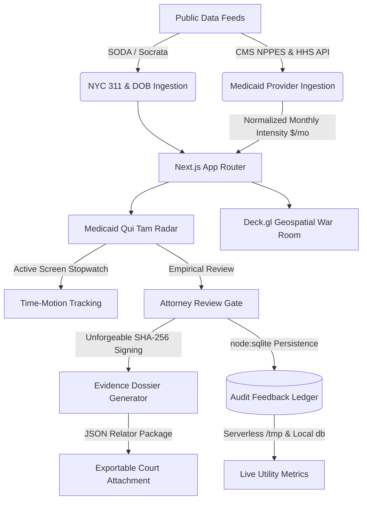

# ESTAFO // Healthcare & Municipal False Claims Act Intelligence Engine

[](tests/verify_pipeline.mjs)
[](https://nextjs.org/)
[](LICENSE)
[](https://vanguard-console.vercel.app)

**ESTAFO** is an enterprise-grade intelligence platform that converts municipal open data and federal healthcare spending records into high-conviction, attorney-verified leads for False Claims Act litigation and research pilots.

It bridges municipal enforcement workflows (Track 4/5 NYC 311 idling and illegal dumping) with specialized Medicaid fraud detection (HCPCS T2024 Adult Day Health Care & CDPAP fiscal intermediaries), enforcing a strict **human review gate** and cryptographic chain of custody.

---

## 🏛️ System Architecture



### Key Engineering Pillars
1. **Normalized Spending Intensity**: Replaces misleading aggregate volume metrics with monthly spending intensity ($\text{total\_spend} / \text{months\_active}$) and $z$-scores against peer cohorts, preventing high-volume legitimate providers from appearing falsely as outliers.
2. **Multi-Signal Alignment**: Requires at least two independent detection vectors (Peer Deviation $\sigma \ge +3.5$, Temporal Velocity Spikes $>200\%$, Impossible Billing $>24\text{h/day}$, or Network Cluster Risk) before prioritizing a lead.
3. **Empirical Time-Motion Tracking**: Measures real attorney screen time via an active session stopwatch, logging verified time saved against a 14.0-hour False Claims Act manual audit benchmark. Exculpatory leads log $0.0$ hours saved.
4. **Relator Disclosure Packages**: Generates cryptographically sealed, immutable JSON evidence dossiers (`ESTAFO_RELATOR_DISCLOSURE_DOSSIER_V1`) directly in the browser via Web Crypto SHA-256 for attachment to pre-filing memos.
5. **Zero-Dependency SQLite Ledger**: Uses native `node:sqlite` for transactional persistence without bloated external binary drivers, with automatic fallback to `/tmp` in serverless cloud environments (Vercel).

---

## 🚀 Quick Start & Local Setup

### Prerequisites
- **Node.js**: v20.x or v22.x+ (must support native `node:sqlite`)
- **Python**: v3.11+ (for `/backend` multi-signal engine)
- **Git**

### Installation

```bash
# Clone the repository
git clone https://github.com/NickAiNYC/Estafo.git
cd Estafo

# Install frontend dependencies
npm install

# Copy environment variables
cp .env.example .env.local

# Run Next.js development server
npm run dev
```

Open [http://localhost:3000](http://localhost:3000) to view the live terminal.

---

## 🧪 Verification & Automated Testing

ESTAFO includes a deterministic 6-gate pre-flight verification suite (`tests/verify_pipeline.mjs`):

```bash
node tests/verify_pipeline.mjs
```

### Verification Gates:
* **Gate G1**: NYC 311 Socrata SODA Live Connectivity (`erm2-nwe9`).
* **Gate G2**: NYC DOB Complaints SODA Live Connectivity (`eabe-havv`).
* **Gate G2b**: NYC DOB Violations SODA Live Connectivity (`3h2n-5cm9`).
* **Gate G3**: Opportunity ENPV Mathematical Integrity ($\text{ENPV} = P \times \text{Gross} - \text{Costs}$).
* **Gate G4**: GAAP Accounting Segregation (Realized Cash strictly isolated from Speculative Bounties).
* **Gate G5**: CMS NPPES Vetted Cohort Checksum (`13f3ef5c5460d27858767429ab1662ebf88e8f36a9c6ae7436879494b01ed0d2`).
* **Gate G6**: Cryptographic Decision Signature Verification.

---

## ⚙️ Environment Variables

Configure `.env.local` based on `.env.example`:

| Variable | Description | Default / Example |
| :--- | :--- | :--- |
| `NYC_OPEN_DATA_APP_TOKEN` | Optional Socrata app token (boosts rate limits to 50k/hr) | `your_token_here` |
| `DATABASE_URL` | Optional PostgreSQL / Supabase connection string | `postgresql://...` |
| `CRON_SECRET` | 32-character hex secret protecting scheduled cron endpoints | `openssl rand -hex 16` |
| `NEXT_PUBLIC_APP_ENV` | Application environment identifier | `production` / `development` |
| `NEXT_PUBLIC_SYSTEM_VERSION` | System release tag | `2.4.0` |

---

## 📂 Repository Structure

```
.
├── app/
│   ├── api/
│   │   ├── feedback/route.ts          # Persistent SQLite feedback ledger & metrics
│   │   ├── sources/
│   │   │   ├── 311-stream/route.ts    # NYC 311 SODA live stream
│   │   │   ├── dob-complaints/route.ts# NYC DOB complaints feed
│   │   │   ├── dob-violations/route.ts# NYC DOB violations feed
│   │   │   └── medicaid-leads/route.ts# Vetted CMS NPPES cohort with z-scores
│   │   ├── ledger/route.ts            # GAAP financial accounting API
│   │   └── opportunities/route.ts     # Multi-signal municipal bounties
│   ├── page.tsx                       # Live mission control & war room
├── backend/                           # Python 3.11 multi-signal & scoring engine
│   ├── app/                           # FastAPI routes & SQLAlchemy models
│   └── scripts/                       # Pre-flight pilot readiness verification
├── components/
│   ├── EvidenceDossier.tsx            # Client-side SHA-256 relator disclosure exporter
│   ├── MedicaidQuiTamRadar.tsx        # Provider intelligence radar & time-motion review
│   └── MapRoom.tsx                    # Deck.gl geospatial Manhattan/Brooklyn corridors
├── db/
│   ├── schema.sql                     # SQLite & PostgreSQL DDL schemas
│   └── estafo_feedback.db             # Local persistent attorney review ledger
├── docs/
│   ├── API_DOCUMENTATION.md           # Full API endpoint schemas and payloads
│   └── MEDICAID_INTELLIGENCE_MOAT.md  # 7-component litigation moat and evidence contract
├── public/data/                       # Grounded fallback datasets & registry manifests
└── tests/
    └── verify_pipeline.mjs            # Deterministic test runner (Gates G1-G6)
```

---

## ⚖️ Legal & Compliance Safeguards

1. **Mandatory Human Legal Review Gate**: No finding or dossier leaves the system without explicit review and cryptographic signoff by qualified counsel or healthcare compliance analysts.
2. **Zero Automated Accusations**: The system strictly forbids automated demand letters, automated whistleblower filings, or defamatory algorithmic assertions.
3. **Four-Tier Evidentiary Standard**: All dossiers strictly separate **FACTS** (adjudicated filings), **INFERENCES** (statistical standard deviations), **ALLEGATIONS** (zero made by platform), and **UNKNOWNS** (pending internal medical charts).

---

## 📄 License
MIT License. See [LICENSE](LICENSE) for details.
