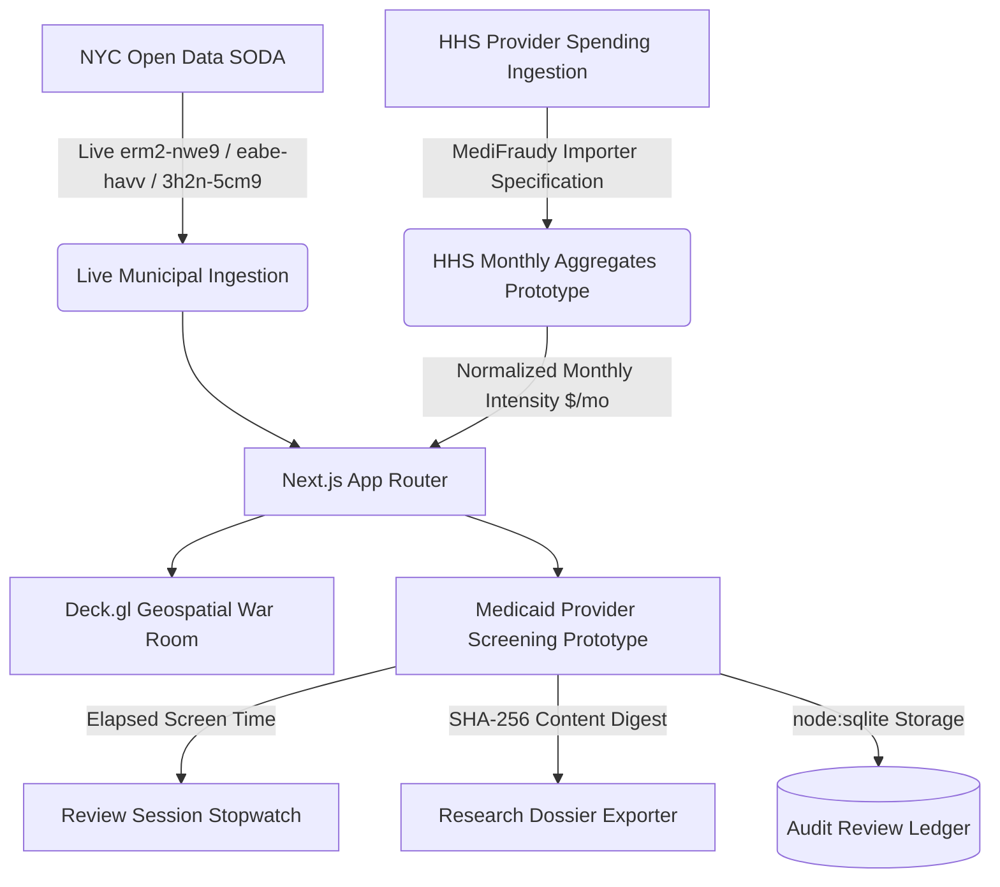

# ESTAFO // Municipal Enforcement & Healthcare Screening Engine

[](tests/verify_pipeline.mjs)
[](https://nextjs.org/)
[](LICENSE)
[](https://vanguard-console.vercel.app)

**ESTAFO** is an investigative intelligence platform connecting live NYC municipal open data (311 idling, commercial dumping, and building violations) with a specialized prototype screening interface for healthcare provider spending.

---

## 🏛️ System Architecture & Data Boundaries



### Data Sources & Strict Operational Boundaries:
1. **Live Municipal Socrata Feeds**:
   - NYC 311 Service Requests (`erm2-nwe9`): Live streaming of idling and dumping citations.
   - NYC DOB Complaints (`eabe-havv`) & DOB Violations (`3h2n-5cm9`): Live structural and safety records.
2. **Medicaid Screening Prototype**:
   - Currently presents a **synthetic demonstration cohort** (HCPCS T2024 Adult Day Health Care) to test the multi-signal screening workflow and review interface.
   - **Important Notice**: Does not query live HHS claims or CMS NPPES APIs. Contains no real provider allegations, verified false claims, or court-adjudicated findings.
   - Sourced live provider leads require running the official MediFraudy HHS quarterly importer (`import_hhs_aggregates.py`) with an independently vetted NYC NPI registry.
3. **Normalized Spending Rate Methodology**:
   - Evaluates provider spending using monthly intensity ($\text{total\_spend} / \text{months\_active}$) and peer $z$-scores to eliminate raw volume bias.
4. **Research Dossier Export (`ESTAFO_RESEARCH_DOSSIER_PREVIEW_V1`)**:
   - Generates a client-side JSON research summary with a SHA-256 content integrity digest.
   - Designed as an internal research aid for compliance analysts and counsel. It is **not** an authenticated legal complaint, subpoena, or proof of fraud.
5. **Zero-Dependency SQLite Ledger**:
   - Uses native Node standard library (`node:sqlite`) storing session review times in `db/estafo_feedback.db` (local dev) or `/tmp/estafo_feedback.db` (ephemeral serverless cloud runtime).

---

## 🚀 Quick Start & Local Setup

### Prerequisites
- **Node.js**: v20.x or v22.x+ (supports native `node:sqlite`)
- **Python**: v3.11+ (for `/backend` multi-signal engine)
- **Git**

### Installation

```bash
# Clone the repository
git clone https://github.com/NickAiNYC/Estafo.git
cd Estafo

# Install frontend dependencies
npm install

# Copy environment variables
cp .env.example .env.local

# Run Next.js development server
npm run dev
```

Open [http://localhost:3000](http://localhost:3000) to view the live terminal.

---

## 🧪 Verification & Automated Testing

Run the 8-gate verification test suite:

```bash
node tests/verify_pipeline.mjs
```

### Automated Verification Gates:
* **Gate G1**: NYC 311 Socrata SODA Live Connectivity (`erm2-nwe9`).
* **Gate G2**: NYC DOB Complaints SODA Live Connectivity (`eabe-havv`).
* **Gate G2b**: NYC DOB Violations SODA Live Connectivity (`3h2n-5cm9`).
* **Gate G3**: Opportunity ENPV Mathematical Integrity ($\text{ENPV} = P \times \text{Gross} - \text{Costs}$).
* **Gate G4**: Financial Accounting Segregation (Realized Cash strictly isolated from Speculative Bounties).
* **Gate G5**: Statistical Spending Intensity Normalization Math (validates peer $z$-score calculation).
* **Gate G6**: Content Digest SHA-256 Hash Generation.
* **Gate G7**: Research Dossier Preview JSON Schema & Mandatory Disclaimers Validation.
* **Gate G8**: Serverless SQLite Storage CRUD Cycle on `/tmp`.

---

## ⚙️ Environment Variables

Configure `.env.local` based on `.env.example`:

| Variable | Description | Default / Example |
| :--- | :--- | :--- |
| `NYC_OPEN_DATA_APP_TOKEN` | Optional Socrata app token (boosts rate limits to 50k/hr) | `your_token_here` |
| `DATABASE_URL` | Optional PostgreSQL / Supabase connection string | `postgresql://...` |
| `CRON_SECRET` | 32-character hex secret protecting scheduled cron endpoints | `openssl rand -hex 16` |
| `NEXT_PUBLIC_APP_ENV` | Application environment identifier | `production` / `development` |
| `NEXT_PUBLIC_SYSTEM_VERSION` | System release tag | `2.4.0` |

---

## ⚖️ Legal & Compliance Safeguards

1. **Mandatory Human Review Gate**: No finding or research summary leaves the system without explicit review by qualified compliance analysts or legal counsel.
2. **Zero Automated Accusations**: The system strictly forbids automated demand letters, automated whistleblower filings, or defamatory algorithmic assertions.
3. **Four-Tier Evidentiary Standard**: All dossiers strictly separate **FACTS** (adjudicated filings), **INFERENCES** (statistical standard deviations), **ALLEGATIONS** (zero made by platform), and **UNKNOWNS** (pending internal medical records).

---

## 📄 License
MIT License. See [LICENSE](LICENSE) for details.
